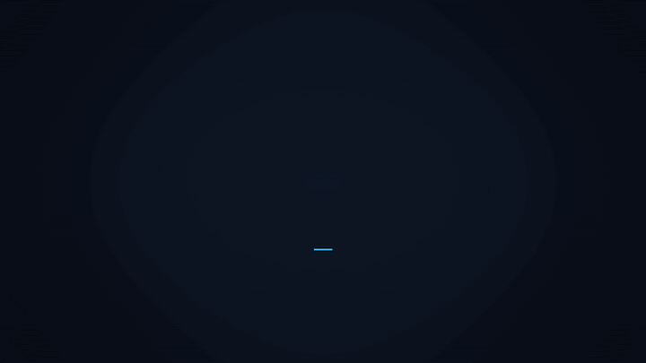

# NowPlayingBar — Windows 11 "Now Playing" Taskbar Widget

<p align="center">
  
</p>

A lightweight, modern Windows 11 desktop overlay application built with C#, WPF, and .NET 8. It displays the currently playing media (artist, title, album art) docked cleanly on the right side of your taskbar, right next to the system tray / clock area.

Reads playback data system-wide from Spotify, YouTube (Chrome/Edge), Apple Music, VLC, and any app supporting Windows System Media Transport Controls (SMTC).

---

## Features

- **Native Windows SMTC Integration**:
  - Subscribes to `CurrentSessionChanged`, `MediaPropertiesChanged`, and `PlaybackInfoChanged` events without tight polling loops.
  - Multi-session support: Prioritizes active playing media, gracefully falls back to paused sessions, and auto-hides when nothing is active.
  - Safe extraction: Protected with comprehensive `try/catch` handlers against misbehaving media apps.
  - Cleans up common trailing noise (e.g. ` - YouTube`, ` - Topic`).

- **Taskbar Docking & Positioning**:
  - Borderless, transparent, non-activating window (`WS_EX_TOOLWINDOW | WS_EX_NOACTIVATE`) that never steals focus or clutters `Alt+Tab`.
  - Automatically identifies taskbar position and notification tray via Win32 (`FindWindow("Shell_TrayWnd")`, `TrayNotifyWnd` with fallback to right-edge offset).
  - High-DPI aware with `PerMonitorV2` support. Dynamically adapts to resolution changes, DPI changes, and taskbar show/hide events.
  - Z-Order preservation: Periodic lightweight reassertion keeps it above Windows 11's taskbar without activating the window.
  - Fullscreen detection: Automatically hides when games, presentations, or full-screen video players are active.

- **Polished Visuals & Low Resource Usage**:
  - 20x20 rounded album art thumbnail + artist & song title.
  - Smooth marquee auto-scroll with gradient fade edges when text exceeds the max configured width; stays static when it fits.
  - Adaptive text color: Automatically syncs with Windows dark/light mode (`SystemUsesLightTheme` / `AppsUseLightTheme`) and updates live.
  - Smooth fade in / fade out animations.
  - CPU usage idle ~0%, RAM < 60 MB.

- **Interactive Controls**:
  - **Left Click**: Play / Pause toggle
  - **Mouse Wheel**: Volume Up / Volume Down (smooth step with native Windows 11 volume overlay)
  - **Progress Bar Click**: Seek to position (track scrub)
  - **Right Click**: Context menu (Next, Previous, Settings, Exit)
  - **Hover**: Full tooltip showing `Artist — Title — Album`
  - Optional **Click-Through** mode (`WS_EX_TRANSPARENT`).

- **Tray Icon & Settings**:
  - System tray icon with quick actions (Show/Hide, Settings, Start with Windows, Exit).
  - Settings UI for adjusting: Offset X/Y, Max Width, Font Size, Marquee Speed, Format template (`{artist} - {title}`), Album art toggle, Click-through toggle, and Autostart.
  - Settings stored in `%AppData%\NowPlayingBar\settings.json`.
  - Logs recorded to `%AppData%\NowPlayingBar\log.txt` (rolling 2 MB file).
  - Single-instance enforcement via named Mutex.

---

## Project Structure

```
NowPlayingBar/
├── src/
│   └── NowPlayingBar/
│       ├── App.xaml / App.xaml.cs          # App lifecycle, tray icon, Mutex
│       ├── app.manifest                    # PerMonitorV2 DPI awareness
│       ├── Native/
│       │   └── NativeMethods.cs            # P/Invoke signatures & Win32 constants
│       ├── Services/
│       │   ├── Logger.cs                   # Rolling file logging (%AppData%\NowPlayingBar\log.txt)
│       │   ├── MediaService.cs             # Windows SMTC session manager & controls
│       │   ├── SettingsService.cs          # JSON config & autostart registry management
│       │   ├── TaskbarLocator.cs           # Taskbar geometry, DPI & fullscreen detection
│       │   └── ThemeService.cs             # Windows light/dark theme tracking
│       ├── Themes/
│       │   └── Generic.xaml                # Control templates
│       └── Views/
│           ├── MarqueeTextBlock.cs         # Smooth marquee scroll text control
│           ├── OverlayWindow.xaml(.cs)     # Docked taskbar overlay window
│           └── SettingsWindow.xaml(.cs)    # Settings dialog UI
└── README.md
```

---

## Build & Run

### Prerequisites
- Windows 10 (19041+) or Windows 11
- .NET 8.0 SDK (or later)

### Development Run
```powershell
# Restore dependencies
dotnet restore src/NowPlayingBar/NowPlayingBar.csproj

# Run in debug mode
dotnet run --project src/NowPlayingBar/NowPlayingBar.csproj
```

### Build Single-File Executable
```powershell
dotnet publish src/NowPlayingBar/NowPlayingBar.csproj -c Release -r win-x64 --self-contained -p:PublishSingleFile=true
```
The compiled single `.exe` file will be located at:
`src/NowPlayingBar/bin/Release/net8.0-windows10.0.19041.0/win-x64/publish/NowPlayingBar.exe`

---

## Manual Verification Checklist

1. **Spotify / Apple Music**: Start a track -> widget appears on the right taskbar area within ~1 sec.
2. **YouTube (Edge/Chrome)**: Play video -> shows Title (cleaned of " - YouTube").
3. **Controls**:
   - Left click on widget -> toggles Play/Pause.
   - Mouse wheel down or middle click -> skips to next track.
   - Mouse wheel up -> skips to previous track.
4. **Taskbar / Start Menu**: Click Windows Start or open notification center -> widget stays visible and does not steal focus.
5. **Theme Switch**: Change Windows Colors between Dark and Light -> widget font color changes live.
6. **Fullscreen**: Open a game or full-screen YouTube (F11) -> widget hides immediately. Exit fullscreen -> widget restores.
7. **Tray Icon**: Right-click tray icon -> Settings or Exit -> process terminates completely with no zombie background tasks.
